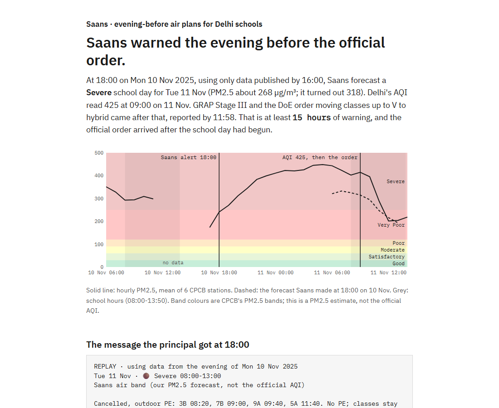
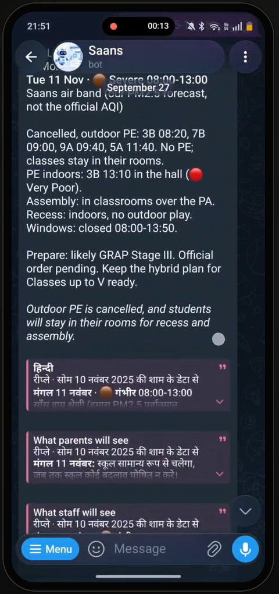
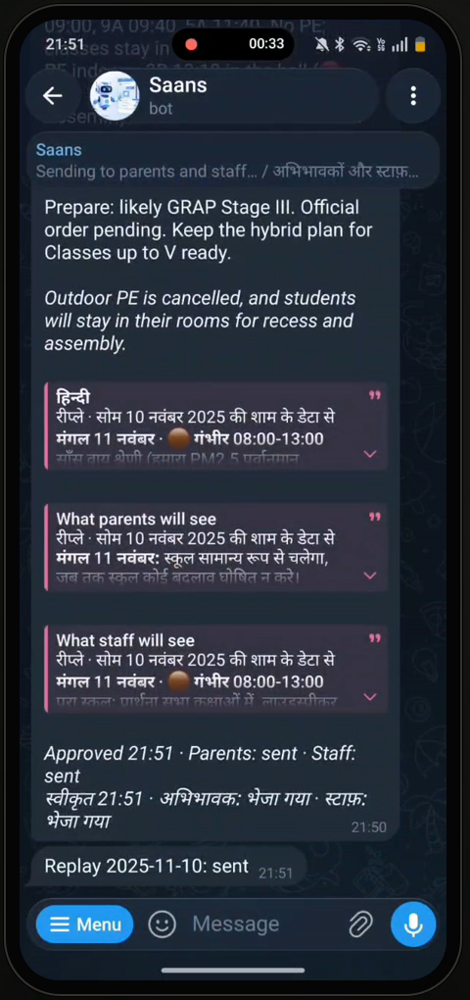
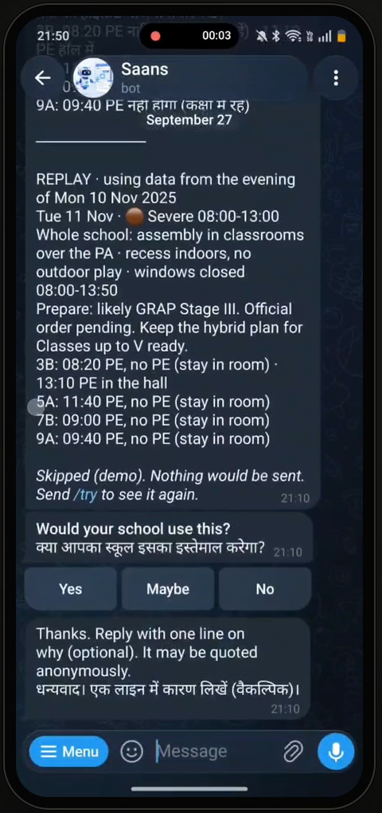
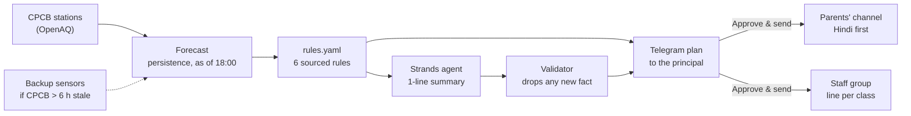
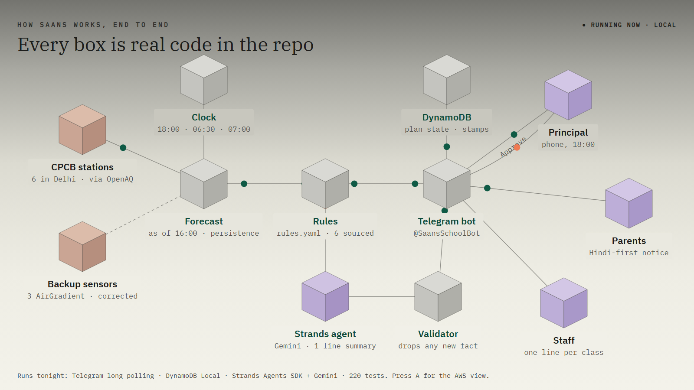
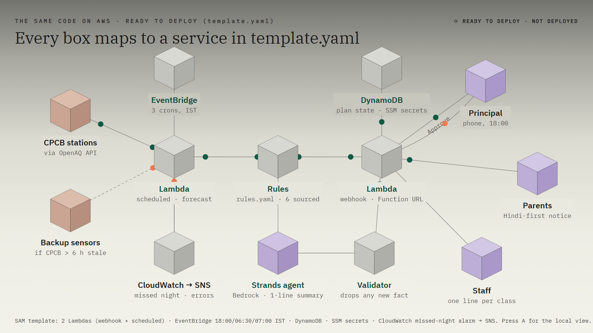

<div align="center">

# 🌫️ Saans

### Evening-before air plans for Delhi schools

*"Saans" (साँस) means breath.*

[](https://github.com/Guten-Morgen1302/saans/actions/workflows/test.yml)


[▶ Demo video](https://youtu.be/Ic-D_1l5Y5M) · [📊 Proof page](https://guten-morgen1302.github.io/saans/) · [🏗️ Animated architecture](docs/architecture.html) · [🤖 Try the bot: send `/try` to @SaansSchoolBot](https://t.me/SaansSchoolBot)

[](https://youtu.be/Ic-D_1l5Y5M)

</div>

---

> **Demo video:** https://youtu.be/Ic-D_1l5Y5M (an earlier cut is kept at [`docs/saans_demo.mp4`](docs/saans_demo.mp4)). The voiceover is AI-generated (Microsoft neural TTS) and the music is synthesized.
> **Proof page:** [`docs/index.html`](docs/index.html) is a self-contained page with the Nov 2025 replay chart, the principal's message, backtest scores and rule sources. Regenerate it with `python backtest/report.py`.

## The problem

On "Poor" and "Very Poor" days (AQI 201-400) no school has to change anything, and official orders only arrive at AQI 401+, often after school has started. Principals decide on the morning of, with no plan and no way to reach parents in time.

## What Saans does

At **18:00 IST on the evening before each school day**, Saans forecasts tomorrow's PM2.5 from CPCB station data and applies fixed, sourced rules: move PE indoors, cancel outdoor activity on Severe days, keep windows shut. It sends the principal a Telegram plan with **Approve & send** / **Skip**. On approval, parents and staff get one bilingual (Hindi + English) post each.

On the evening of 10 Nov 2025, using only data published by 16:00, Saans would have forecast a Severe school day for 11 Nov. GRAP Stage III and the Delhi DoE hybrid-classes order came the next morning, at least **15 hours** later.



## On a real phone

Screen recording from the demo video, running against the live bot (`@SaansSchoolBot`).

<table>
  <tr>
    <td align="center" width="33%"></td>
    <td align="center" width="33%"></td>
    <td align="center" width="33%"></td>
  </tr>
  <tr>
    <td align="center"><b>1. The plan arrives</b><br>English plan, Hindi and parent/staff previews</td>
    <td align="center"><b>2. One tap: Approve</b><br>Parents and staff posted, outcome stamped</td>
    <td align="center"><b>3. <code>/try</code>, for anyone</b><br>Same plan in your own chat, then "Would your school use this?"</td>
  </tr>
</table>

## At a glance

| | |
|---|---|
| **Forecast** | Pure persistence from CPCB hourly PM2.5, made as of 18:00 using only data published by 16:00. Chosen by the backtest. |
| **Backtest** | 44 school days, Oct-Dec 2025. Very Poor-or-worse days: **86% caught, 11% false alarms**. Poor-or-worse: 98% caught, 0% false alarms. |
| **Rules** | 6 rules in [`rules.yaml`](rules.yaml), each citing EPA, CPCB or CAQM sources. Adaptations are labelled. |
| **AI** | A Strands agent writes an optional one-line summary. A validator drops it if it adds any number, time, class or band that is not in the plan. |
| **Languages** | Hindi-first notice for parents, English plan for the principal, a line per class for staff. |
| **Resilience** | If the CPCB feed is more than 6 hours stale, three outdoor AirGradient sensors (corrected to CPCB levels) take over, and the message says so. |
| **Tests** | 220 passing. |

## Trust by design

- **Rules decide, AI writes.** The model never sets a threshold. Every action carries a rule id and a source.
- **Parents never see class names.** Asthma counts stay private (counts only, never names).
- **Uncertain guesses stay internal.** Severe-day forecasts are right about 60% of the time with about 50% false alarms, so the "likely GRAP Stage III" warning goes to the principal and staff only.
- **One decision, one tap.** Every outcome (approved, skipped, expired, could not post) is stamped on the plan, and double taps or late approvals are rejected by conditional DynamoDB updates.
- **Honest labelling.** "Saans air band" is our PM2.5 forecast mapped onto CPCB bands. It is **not the official AQI**.

## How it works



**Running tonight (local):** Telegram long polling, DynamoDB Local, Strands Agents SDK with Gemini.



**The same code on AWS ([`template.yaml`](template.yaml), ready to deploy, not deployed):** two Lambdas, EventBridge crons, DynamoDB, SSM secrets, a CloudWatch missed-night alarm to SNS, and Bedrock for the summary.



Animated version: [`docs/architecture.html`](docs/architecture.html). Press A to switch between the local run and the AWS mapping.

### Where things live

- [`saans/forecast.py`](saans/forecast.py): the forecast, using only the data available at 18:00.
- [`rules.yaml`](rules.yaml) and [`saans/rules.py`](saans/rules.py): the rules and the engine (most restrictive rule wins).
- [`saans/messages.py`](saans/messages.py) and [`saans/templates.py`](saans/templates.py): English and Hindi messages.
- [`saans/summary.py`](saans/summary.py): the Strands agent summary and its validator (Gemini locally, Amazon Bedrock on AWS).
- [`saans/lifecycle.py`](saans/lifecycle.py): the plan state machine (SENT → APPROVED / SKIPPED / EXPIRED → POSTED / FAILED).
- [`saans/trial.py`](saans/trial.py): the public `/try` demo and feedback collection.
- [`scripts/run_local.py`](scripts/run_local.py) runs everything on a laptop. [`template.yaml`](template.yaml) deploys the same code on AWS.

## Built with AWS

**AWS open source:** [Strands Agents SDK](https://github.com/strands-agents/sdk-python) for the summary agent.

**AWS services:** DynamoDB (plan state, via DynamoDB Local for the demo), Lambda (webhook behind a Function URL, plus the scheduled job), EventBridge (18:00 / 06:30 / 07:00 IST crons), Systems Manager Parameter Store (secrets), CloudWatch alarms with SNS (missed-run and error alerts), and Amazon Bedrock (the summary model on AWS). All of these are defined in [`template.yaml`](template.yaml). The demo itself runs locally, with no AWS account.

## Run the tests

```bash
python -m venv .venv && .venv/Scripts/pip install -r requirements-dev.txt   # Windows
python -m pytest -q
python backtest/run.py        # needs data/raw/pm25_hourly.csv (scripts/backfill.py)
```

## Run it locally (no AWS account, no card)

This is how the demo runs. It uses the Strands Agents SDK (an AWS open-source tool) with a free Gemini key for the summary, Amazon's DynamoDB Local in Docker, and Telegram long polling, so no public URL is needed.

1. **Telegram:** create a bot with @BotFather. Create a parents' channel and a staff group, plus demo copies of both, and add the bot as an admin to each.
2. **Ids:** get the numeric ids for yourself (principal/admin) and the four chats, e.g. by forwarding a message from each to @userinfobot.
3. `cp .env.example .env` and fill it in. `GEMINI_API_KEY` is optional; it's free at aistudio.google.com.
4. Start Docker Desktop, then run `docker compose up -d` to start DynamoDB Local.
5. `python scripts/run_local.py`. Leave it running: the 18:00 plan, the 06:30 reminder and the 07:00 expiry run only while it's on.
6. Try it: as the admin, send the bot `/replay 2025-11-10`. Anyone can send `/try` for a private demo in their own chat, which ends with a "Would your school use this?" question. Admins see the tally with `/feedback`.

## Deploy on AWS (optional)

`template.yaml` deploys the same code as two Lambdas (a Telegram webhook, plus the 18:00 / 06:30 / 07:00 IST crons), DynamoDB, a missed-run alarm and secrets in SSM. It needs an AWS account (and a card):

```bash
aws ssm put-parameter --type SecureString --name /saans/telegram_bot_token --value '<token>'
aws ssm put-parameter --type SecureString --name /saans/telegram_webhook_secret --value "$(openssl rand -hex 32)"
aws ssm put-parameter --type SecureString --name /saans/openaq_api_key --value '<key>'
sam build --use-container && sam deploy --guided --stack-name saans   # first time
make deploy                                                           # later: build, deploy, smoke test
python scripts/set_webhook.py --stack saans
```

## Data

CPCB hourly PM2.5 via the [OpenAQ](https://openaq.org) API, for six Delhi stations (`config/stations.yaml`). If the CPCB feed is more than 6 hours old, Saans switches to three outdoor AirGradient sensors on the same API. Each sensor is corrected to CPCB levels (`scripts/fit_fallback.py`). In an out-of-sample check it caught 91% of Very Poor-or-worse days with 17% false alarms. The principal's message says when backup data was used. `saans/data/replay_2025q4.csv` ships the Oct-Dec 2025 station means so replays work offline.

## Known limits

- One demo school (`school.yaml`). Multi-school onboarding is in `TODOS.md`.
- Severe-day forecasts are right about 60% of the time, with about 50% false alarms. That's why the GRAP warning goes to the principal and staff only.
- The Hindi copy needs a native-speaker check before real use.
